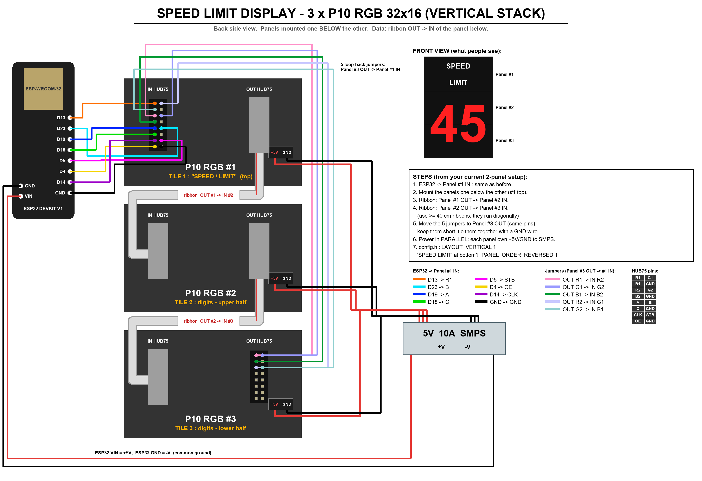

# Speed Limit Display: ESP32 + 3 × P10 RGB 32x16 + secure BLE app

Panels are mounted **one below the other** (32 × 48), `LAYOUT_VERTICAL 1` in `config.h`:

```
 +--------+
 | SPEED  |  Tile 1 (Panel #1, top)
 | LIMIT  |
 +--------+
 |        |  Tile 2 (Panel #2)
 |   45   |       2-digit speed limit, 14x30 px per digit, 2 px "double pixel" strokes
 |        |  Tile 3 (Panel #3, bottom)
 +--------+
```

- **Tile 1**: "SPEED" on the top half and "LIMIT" on the bottom half.
- **Tiles 2 + 3**: the speed limit (**0–99**), drawn over both panels with a tall double-pixel font.
- Side-by-side mounting (96 × 16) is still supported: set `LAYOUT_VERTICAL 0`.
- The limit is set **per display** from the phone app over BLE.
- Each value is saved in NVS (Preferences), so the display shows the same value after a power cut.
- Each display advertises its own name (`SpeedDisplay1`, `SpeedDisplay2`, …). The app identifies displays by their **BLE MAC address**.
- **Security:** only our app *with that display's own key* can change anything (details below).

```
SpeedLimitDisplay_BLE/
├── firmware/SpeedLimitDisplay/     Arduino sketch (ESP32)
│   ├── SpeedLimitDisplay.ino
│   ├── config.h                    <- device name, panels, secrets, UUIDs
│   ├── BigDigits.h                 <- 7x8 digit font, stretched with 2 px strokes
│   └── Security.h                  <- HMAC helpers
└── mobile-app/                     React Native (Expo) app
    ├── App.js
    └── src/ (config.js, protocol.js, ble.js, storage.js, ui.js, screens/)
```

The original tested project `ESP32 _ ESP32 P10 RGB 32x16` was **not changed**.

---

## 1. Hardware / wiring (3 panels, one below the other)



(`Wiring_3_Panels.png` shows the side-by-side version, for `LAYOUT_VERTICAL 0`.)

Use the same ESP32 pins as the tested sketch (`LAT=5, A=19, B=23, C=18, OE=4`, data `R1=D13`, `CLK=D14`).

**Why the data cannot be in parallel:** if all three panels got the same HUB75 signals, all three would show the *same* picture. To show "SPEED LIMIT" on one panel and the digits on the others, the data must go through the ribbons OUT → IN. Only the **power** is in parallel. The physical mounting (one below the other) is handled in software.

```
          ESP32 ──► [Panel 1 IN] ... [Panel 1 OUT]      (top)
                         ▲                 │ ribbon
                         │      [Panel 2 IN] ... [Panel 2 OUT]
                         │                         │ ribbon
                         │      [Panel 3 IN] ... [Panel 3 OUT]   (bottom)
                         └──── 5 loop-back jumpers ──┘
```

| Jumper | Panel 3 OUT | Panel 1 IN |
|---|---|---|
| Pink | R1 | R2 |
| Lavender | G1 | G2 |
| Dark green | B1 | B2 |
| Light lavender | R2 | G1 |
| Teal | G2 | B1 |

- The ribbons run diagonally (OUT on the right → IN on the left of the panel below), so use ribbons of **at least 40 cm**.
- Keep the 5 jumpers as short as possible and bundle them with a GND wire. They carry data at 10 MHz.
- If the image is noisy, lower `PxMATRIX_SPI_FREQUENCY` (for example to 8000000).
- If "SPEED LIMIT" appears on the bottom panel, set `PANEL_ORDER_REVERSED 1` in `config.h`. No rewiring is needed.
- **Power:** use a **5 V 10 A** PSU. Run a separate +5 V/GND pair from the PSU to each panel (parallel), and connect the PSU GND to the ESP32 GND.

## 2. Firmware

**Software:** use the same versions as the tested sketch, plus one new library.

| Item | Version |
|---|---|
| ESP32 Arduino core | 2.0.x (tested build: 2.0.17) |
| Adafruit GFX + BusIO | as already installed |
| PxMatrix | 1.8.2 |
| **NimBLE-Arduino** by h2zero | **1.4.x** (e.g. 1.4.3). **Do not use 2.x**, its API is different. |

Install it from Arduino IDE → Library Manager → "NimBLE-Arduino" → choose version **1.4.3**.

**For each display:**

1. Open `firmware/SpeedLimitDisplay/config.h` and set `#define DEFAULT_DEVICE_NAME "SpeedDisplay1"`. Use `SpeedDisplay2`, `SpeedDisplay3`, … for the other displays.
2. Upload with Board: **ESP32 Dev Module**. The sketch is about 640 KB, so the default partition is fine.
3. On the **first boot**, the display generates its own random **device key** (for example `K7P3MX9Q`). It shows the key on the panel for 60 s and prints it in the Serial Monitor (115200).
   **Write it down.** A sticker inside the enclosure works well. You need it once per phone to add the display.
4. After that, the display shows `SPEED LIMIT 40`. This is the default; it changes to whatever you set from the app.

**Lost the key?** Hold the **BOOT button for 5 seconds** while the display is running. It generates a new key and shows it for 60 s. Phones that used the old key must add the display again. This needs physical access to the board.

> Re-flashing with a different `DEFAULT_DEVICE_NAME` automatically switches to the new name. The limit and key are kept.
> To wipe everything, use Tools → *Erase All Flash Before Sketch Upload: Enabled*.

## 3. Mobile app (React Native / Expo)

BLE needs native code, so **Expo Go will not work**. Build a dev or release APK:

```bash
cd mobile-app
npm install
npx expo install --fix          # aligns package versions with the Expo SDK
npx expo run:android            # phone connected via USB (Android Studio / SDK needed)
#   or, cloud build of an installable APK:
npx eas build -p android --profile preview
```

**Using the app:**

1. **Add display:** the app scans and lists only our displays (it filters on our service UUID). Tap one and enter its **device key**.
2. The app verifies the key, reads the display's MAC, and saves the display in the phone's **secure storage** (Android Keystore / iOS Keychain).
3. Tap a display. Set the limit with the number box, the ±5 buttons or the quick buttons, then tap **Set speed limit**. The value shows instantly and is saved on the display.
4. You can also set the brightness, the digit and text colours, rename the display (it restarts with the new BLE name) and change the device key.

## 4. Security protocol

| Threat | Protection |
|---|---|
| A generic BLE app (nRF Connect, etc.) writes data | Every command must carry an HMAC-SHA256 signature. Without the keys, every write is rejected. |
| Someone else has *our app* but not *your* display's key | Every display has its **own key**, so their app cannot sign commands for your display. |
| Recorded or replayed packets | The display sends a **new random 128-bit challenge (nonce) on every connection**, plus an increasing counter per command. Old packets are useless. |
| A fake display pretends to be yours | Responses are signed too, and the app checks the MAC address. A fake display gets the error "not a genuine display". |
| Brute-forcing the key | After 3 wrong signatures the display disconnects and refuses connections for 30 s. |
| Someone stays connected to block the display | Unauthenticated connections are dropped after 15 s and idle ones after 2 min. |
| The key is sniffed over the air | The key is **never sent**. Only HMACs are. When you change the key, the new key is sent encrypted. |

**How it works:**

```
K        = HMAC-SHA256(APP_SECRET, "SDK1|" + DEVICE_KEY)        (both sides, never transmitted)
App  -> reads NONCE characteristic (random, new per connection)
App  -> CMD : "<ctr>|<command>|" + HMAC(K, nonce|ctr|command)[0..32 hex]
Disp -> RESP: "<ctr>|OK|<state>|" + HMAC(K, nonce|R|ctr|OK|state)[0..32 hex]
Commands: AUTH, GET, LIM:<0-99>, BRI:<5-255>, COL:<digit>,<text>, NAME:<name>, KEY:<encrypted>, RST
```

`APP_SECRET` is shared by the app and the firmware. **Change it to your own random value in both** `firmware/SpeedLimitDisplay/secrets.h` and `SpeedDisplayApp/src/secrets.js` (both git-ignored; start from the `secrets.example.*` files) before you deploy, and keep them identical.

Note: anyone who decompiles the APK can extract `APP_SECRET`, but that alone is still not enough. The per-display device key is the real protection.

## 5. Troubleshooting

| Problem | Fix |
|---|---|
| Image noisy or ghosting | Same as the tested sketch: adjust `PxMATRIX_SPI_FREQUENCY` (10 MHz is the current value). |
| "SPEED LIMIT" on the wrong panel | Set `PANEL_ORDER_REVERSED 1`. |
| Digits look split or shifted between panels 2 and 3 | Check that `LAYOUT_VERTICAL` matches how the panels are mounted. |
| Panels 2 and 3 are dark or garbled | Check the ribbon cables (OUT→IN). The loop-back jumpers must go to the **last** panel's OUT. |
| App shows "Wrong device key" | Check the key. After 3 wrong tries, wait 30 s. |
| Display not found in the scan | Turn on Bluetooth and allow the Nearby-devices permission. Only one phone can be connected to a display at a time. |
