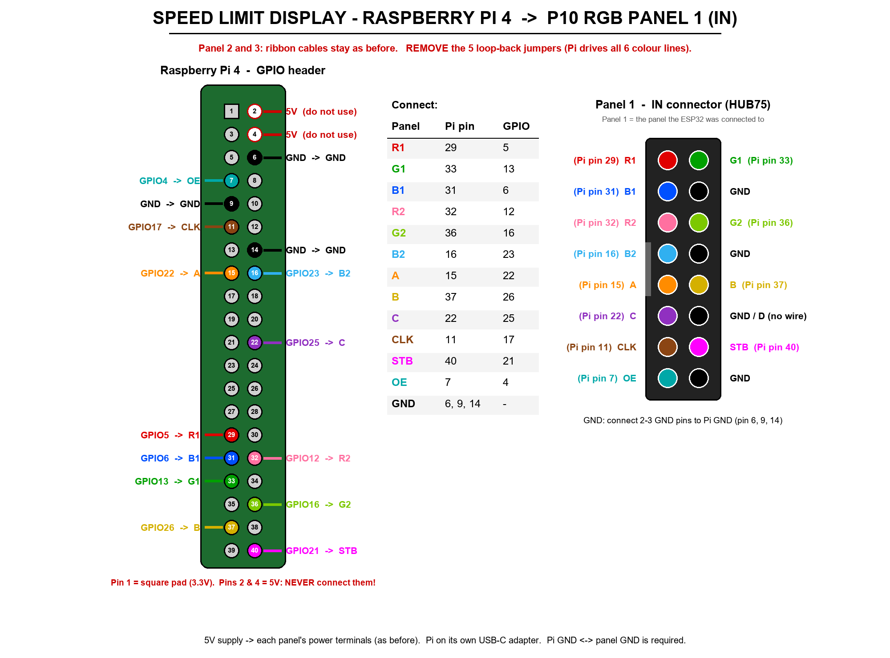

# Speed Limit Display – Raspberry Pi 4 (Wi-Fi)

Same sign as the ESP32 version (3 x P10 RGB 32x16, 2727-8S, 1/8 scan; green **SPEED / LIMIT**,
blue ring, bold red digits), but driven by a Raspberry Pi 4 and set from the phone over **Wi-Fi**
instead of Bluetooth. The same app (`SpeedLimitDisplay_BLE/SpeedDisplayApp`) controls both kinds.

- Panels: [hzeller/rpi-rgb-led-matrix](https://github.com/hzeller/rpi-rgb-led-matrix) with our own
  GPIO mapping **`speeddisplay`** (added by `install.sh`)
- API: plain HTTP on port **8099**, every command signed with the same HMAC protocol as BLE
  (needs `APP_SECRET` + the display's device key, nonce per session, replay counter, lock-out)
- Settings + device key: `/var/lib/speeddisplay/settings.json`

## Wiring (Pi 4 -> Panel 1 IN)



The Pi drives all six colour lines itself, so **remove the 5 loop-back jumpers** that the ESP32
version needs. The ribbon cables between the panels stay as they are
(Panel 1 OUT -> Panel 2 IN, Panel 2 OUT -> Panel 3 IN).

| HUB75 (Panel 1 IN) | Pi GPIO | Pi physical pin |
|---|---|---|
| R1  | GPIO 5  | 29 |
| G1  | GPIO 13 | 33 |
| B1  | GPIO 6  | 31 |
| R2  | GPIO 12 | 32 |
| G2  | GPIO 16 | 36 |
| B2  | GPIO 23 | 16 |
| A   | GPIO 22 | 15 |
| B   | GPIO 26 | 37 |
| C   | GPIO 25 | 22 |
| CLK | GPIO 17 | 11 |
| STB / LAT | GPIO 21 | 40 |
| OE  | GPIO 4  | 7 |
| GND | GND     | 6, 9, 14, 20, 25, 30, 34 or 39 (use 2-3 of them) |

- D (and E) are not used by 16-row panels – leave the HUB75 D pin unconnected.
- GPIO 27, 10 and 18 are **not** used (relay / LED strip / audio of the other projects on this Pi),
  nor UART (14, 15), I2C (2, 3) or SPI0 (7-11).
- Panels get 5 V from their own supply (as before). Pi GND and supply GND must be connected.
- The Pi outputs 3.3 V; P10 panels normally accept it with short wires (< 20 cm). If the picture
  flickers or shows wrong pixels, raise `gpio_slowdown` or add a 74HCT245 level shifter.

## Install

```bash
git clone https://github.com/sudodevjay/speedlimit.git
cd speedlimit/SpeedLimitDisplay_Pi
sudo ./deploy/install.sh
```

Then:

- Live preview (works without panels): `http://<pi-ip>:8099/`
- Device key (also shown on the panel for 60 s at the first start): `sudo journalctl -u speeddisplay | grep KEY`
- Logs: `journalctl -u speeddisplay -f`

Settings in `/etc/speeddisplay/config.ini` (restart after a change: `sudo systemctl restart speeddisplay`):

| Setting | Meaning |
|---|---|
| `name` | Name shown in the app (SpeedDisplayPi1, SpeedDisplayPi2, ...) |
| `preview_only = yes` | Do not touch the GPIO, only serve the preview (testing without panels) |
| `flip_mask`, `order_reversed` | Same as `PANEL_FLIP_MASK` / `PANEL_ORDER_REVERSED` in the ESP32 `config.h` |
| `gpio_slowdown` | 2-4 on a Pi 4; higher if the image is unstable |
| `multiplexing`, `row_address_type` | Only if the image is scrambled (see hzeller docs) |
| `app_secret` | Must match `SpeedDisplayApp/src/secrets.js` |

New device key (like holding BOOT on the ESP32):

```bash
sudo systemctl stop speeddisplay
sudo PYTHONPATH=/opt/speeddisplay /opt/speeddisplay/venv/bin/python -m speeddisplay newkey
sudo systemctl start speeddisplay
```

## Video mode (USB stick)

In the app (Wi-Fi displays only): **Display shows -> Speed limit / Video (USB)**.

- Video mode plays every video on the USB stick (`.mp4 .mkv .avi .mov .webm .gif ...`, also in
  sub-folders) in a loop, plus the files in `/var/lib/speeddisplay/videos`.
- The stick is found automatically (desktop auto-mount, or the service mounts it read-only at
  `/run/speeddisplay/usb`). New files are picked up after the current loop.
- **No stick / no videos -> the sign shows the speed limit**, so it is never blank on the road.
- **From anywhere over SSH / Tailscale:** copy videos into `~/speeddisplay/videos` on the Pi, e.g.
  `scp myvideo.mp4 housys@housys-pi:speeddisplay/videos/` - it plays after the current video
  (files that are still being copied are skipped until they stop changing for 10 s).
  Delete a file there to remove it from the loop.
- The chosen mode is saved and comes back after a power cut.
- The sign is only 32 x 48 pixels: simple animations, logos and big text look best; a normal film
  only shows colours and movement. `[video] fit = fill` (cut the sides) or `fit` (black bars).
- No sound (the panels have no speaker).

## App

In the app: **+ Add display -> + Wi-Fi display (Raspberry Pi)** -> enter the Pi's IP address
(same Wi-Fi, e.g. `192.168.1.94`, or its Tailscale IP from anywhere) and the device key.

## API (for reference)

| Request | Response |
|---|---|
| `GET /api/info` | `{"name","mac","fw","transport":"wifi"}` |
| `POST /api/session` | `{"sid","nonce"}` – like a new BLE connection |
| `POST /api/cmd` (header `X-Session`, body `<ctr>\|<cmd>\|<mac>`) | `<ctr>\|<OK or ERR>\|<payload>\|<mac>` |
| `GET /preview.png` / `/preview-chain.png` | the sign / the raw panel chain |

Commands: `AUTH`, `GET`, `LIM:<0-99>`, `BRI:<5-255>`, `COL:<digit>,<text>`, `NAME:<name>`,
`KEY:<encrypted>`, `RST` – identical to the ESP32 firmware.
